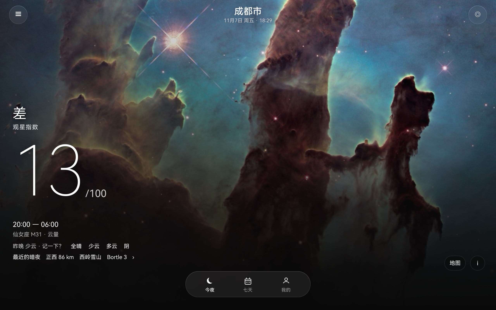

# 今夜星 · Night Window

一个把「今晚适不适合看星星」压缩成一个数字的 HarmonyOS 应用。



## 这是什么

打开就是一张星空照片和一个 0–100 的分数。没有列表、没有地图、没有模式切换——
先给结论，细节收在 ⓘ 和底部 Dock 里。

```
综合分 = 天气分 × 天空分 ÷ 100
```

| 分项 | 权重/口径 |
|---|---|
| 天气分 | 云量 0.55 · 通透 0.20 · 视宁 0.15 · 露点 0.10，再乘目标高度角对应的大气质量衰减 |
| 天空分 | Bortle 等级系数 × 月光压制（月相 + 月亮高度 + 与目标角距） |

白天看不到星星，所以深空观测还要求**天文夜**（太阳高度 < −18°）。

## 当前状态

| 能力 | 状态 |
|---|---|
| 天文内核（月相/高度角/大气质量/角距/太阳高度） | ✅ 完成，纯函数、零系统依赖 |
| 评分模型 | ✅ 完成 |
| 首屏 / 七天 / 数据 / 我的 | ✅ 完成（状态管理 V2） |
| 底部 Dock | ✅ 官方 Tabs 玻璃浮岛（沉浸光感）+ 毛玻璃按钮 |
| 城市切换 / 地图（花瓣地图，夜间样式 + GCJ-02 纠偏） | ✅ 完成 |
| 两档定位（城市级秒出 + 精确静默更新） | ✅ 完成 |
| **真实天气数据** | ⚠️ **未接入**，用的是写死的演示数据 |
| **光污染栅格** | ⚠️ **未接入**，Bortle 来自内置的 10 个站点表 |

**请注意**：天气那一列目前是 `viewmodel/TonightViewModel.ets` 里的常量数组，
分数能算对，但气象输入是假的。接真实数据需要华为 Weather Kit 的开放能力授权。

## 构建

需要 DevEco Studio（API 26 SDK，兼容 API 23）。

```bash
# 用 DevEco 打开本目录
# Project Structure → Signing Configs → 勾选 Automatically generate signature
# 然后 Run
```

命令行构建：

```bash
export DEVECO_HOME="/Applications/DevEco-Studio.app/Contents"
export DEVECO_SDK_HOME="$DEVECO_HOME/sdk"
export NODE_HOME="$DEVECO_HOME/tools/node"
export NODE_PATH="$PWD/node_modules"
mkdir -p node_modules/@ohos
ln -sfn "$DEVECO_HOME/tools/hvigor/hvigor" node_modules/@ohos/hvigor
ln -sfn "$DEVECO_HOME/tools/hvigor/hvigor-ohos-plugin" node_modules/@ohos/hvigor-ohos-plugin

"$NODE_HOME/bin/node" "$DEVECO_HOME/tools/hvigor/hvigor/bin/hvigor.js" \
  --mode module -p product=default -p buildMode=debug --no-daemon assembleHap
```

**仓库里没有任何签名材料。**`build-profile.json5` 的 `signingConfigs` 是空数组，
调试签名由 DevEco 自动生成并写入 `~/.ohos/config`。

## 目录

```
entry/src/main/ets/
├── core/
│   ├── astro/Astro.ets        儒略日、月球星历、高度角、大气质量、角距
│   ├── geo/Coord.ets          WGS-84 ⇄ GCJ-02 坐标转换
│   ├── score/Score.ets        评分模型、窗口搜索
│   └── data/                  数据类型、暗夜站点表
├── viewmodel/                 状态与用例
├── pages/Index.ets            首屏 / 七天 / 我的 / 数据 / 地图
├── common/                    日志、反馈本地存储
└── entryability/
```

`core/astro` 不 import 任何 `@ohos.*`，可以脱离 HarmonyOS 单独测试或移植。

底部 Dock 用官方 `Tabs` + `BottomTabBarStyle` + `barFloatingStyle` 的沉浸光感玻璃浮岛；
☰ / ◎ / 地图 / i 等自绘按钮不在系统材质的生效范围（仅 Navigation 标题栏与底部 TabBar 生效），
改用 `backgroundBlurStyle` 做同观感毛玻璃。

全部状态使用 **V2**：`@ObservedV2` + `@Trace` 建模、`@ComponentV2` + `@Local` 做 UI 状态、
`@Computed` 派生。业务状态住在 `TonightViewModel` 里，页面只读不搬。

## 已知问题

- 天气是演示数据，分数只能反映算法逻辑，不能反映真实夜空
- 光污染只有 10 个内置站点，城市边缘的 Bortle 会算粗
- 地图只有"找暗夜地点"一个入口，没有 POI 搜索
- 图标资源是占位图

## 素材授权

背景图来自 **ESA/Hubble & NASA**，CC BY 4.0，详见 [CREDITS.md](CREDITS.md)。

## 许可证

[Apache License 2.0](LICENSE)
